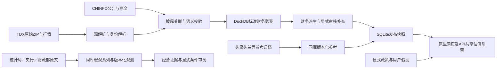

# 数据与估值架构

本页描述当前结构和不变约束；实现范围见[项目状态](implementation-status.md)，历史设计见[早期设计](history/design-v0.md)，具体语义决策见[ADR索引](decisions/README.md)。当前只维护schema59，不保留旧模型兼容层。

## 数据流与责任

TDX是结构化财务数值主源；CNINFO负责公告身份、披露时间、合并范围及原文核验，不静默覆盖TDX。标准字段使用通用业务名称，源编号仅在解析、映射及来源证据中出现。估值方法以达摩达兰原始资料为准，事实、代理与预测分层。

AlphaLake交付事实、参考、确定性派生及显式假设，valuation消费固定契约执行估值。当前优先解决数据侧缺口；引擎暂时冻结，仅修明确BUG；非BUG调整及必要接口扩展进入[待审批](../valuation/TODO.md)，获批前不实施。全部历史改动、达摩达兰依据与待处置项见[架构边界及引擎调整台账](valuation/engine-change-ledger.md)，不能把原页面保留说成引擎未改。

## 存储分层

| 层次 | 当前职责 |
|---|---|
| `core` | 公司、证券、上市及来源标识，按业务时点解析身份 |
| `market` / `classification` | 未复权行情、股本/行动、汇率和时态分类 |
| `fundamental` | 源记录定位、公告关联、标准财务宽表、拒绝原因、逐期间审核补充 |
| `reference` | 版本化国家/行业、风险与成本参考及同发行人审核关联；不是公司财务事实 |
| `macro` | 全国需求、价格、经营周期、信用与财政统计；保留标准系列定义、期间及修订，不自动填公司预测 |
| `meta` | 原始归档、发布版本、运行、检查点与治理记录 |
| workspace派生文件 | SQLite、估值运行与研究结果，可按输入和版本重建 |

唯一主库是`workspace/alphalake.duckdb`。原始证据按来源归档，源ZIP已保存时不在数据库重复持久化BLOB、原位值或源字段长表。

宏观`series`／`observation`共用`meta`归档与发布版本，不与公司财务、市场价格或达摩达兰估计混存；研究通过标准查询读取，财务SQLite不携带宏观副本。期间、单位与手工刷新见[宏观指南](guides/macro-data.md)，设计依据见[ADR025](decisions/025-macroeconomic-observations.md)。

财务源层`fundamental.source_record`只保存归档、原行和身份定位；`statement_snapshot`按来源记录宽行存标准列，金额采用`DECIMAL(38,10)`，不恢复float32已经丢失的精度。拒绝按记录/规则归并，字段运行血缘只在内容变化时更新。批量查询先限定证券、期间和标准列，禁止逐字段入库或逐公司启动导出进程。基准及发布门槛见[财务存储约束](guides/financial-storage-redesign-20260925.md)。

## 语义与治理

- 证券身份不靠代码前缀猜测；歧义保留，默认批量范围只含沪深，北交所历史不删除。
- 报告期、公告时间、首次取得及系统记录时间分别保存。CNINFO只有日期时，到中国次日零点才可用于PIT；新取得的旧包不冒称当时已留存。
- 累计流量、单季流量、期末余额、每股数值不能混合加总。年度/TTM从已审核标准事实派生；源零不等于披露零。
- 原文核实的余额零通过绑定源归档、映射、公告和PDF的审核补充进入出口，不改标准事实。撤销或绑定失效后重导出恢复缺项。规则见[审核通道](guides/reviewed-evidence-history.md)。
- 原始证据不可变；失败快照不能覆盖可信历史、关闭身份区间或推进完成检查点。对应数据与检查点原子提交，重放幂等。
- 来源当前可用、上游最新、字段齐备、模型准入、估值产出和经济合理性分别验收。

## 应用契约

`reference.issuer_industry_review`每次审核导入保存一份验证包及完整事件链，原文、清单与官方工作簿各自绑定归档；精确证券条目优先，最新撤销或源版本失效不复活旧关联。关联只补参考取数，不复制源名单、财务值或多股类市值。

SQLite是原Investment_Valuation_Agent的可重建输入快照，交付原公司/年度/季度宽表、已有TTM、参考及每证券紧凑上下文；网页只读SQLite，不打开DuckDB或启动Go。完整事实、来源、审核和资产组成诊断由DuckDB/原始归档提供，研究显式查询数据侧。结构见[消费快照spec](valuation/sqlite-input-snapshot-spec.md)与[导出契约](guides/valuation-sqlite-export.md#sqlite证据存储契约)。保留原页面、流程与冻结引擎，默认参考、用户修改和人民币条件不混称公司市场WACC。

v12撤销五张事实/逐格/治理辅助表，不以别名、视图或大JSON重建第二权威库。普通已供给状态由宽表推导，实际缺项/冲突/审核引用稀疏保存；完整候选分母留在数据侧发布收据。网页响应明确来源证据尚未展开，不能因没有内嵌完整原文拒绝已验证值。

原生发布由已有同步、导出、检查和原子切换组成，失败恢复旧快照，成功后用真实API核对输入与结果。CLI/Skill的显式政策估值保留自己的运行标识，不与原生默认估值混同。细节见[发布手册](guides/system-delivery.md)和[导出契约](guides/valuation-sqlite-export.md)。

## 资源与演进

大库操作和全套测试串行运行于独立systemd服务，核验进程硬限额；DuckDB查询预算不是RSS上限。性能、证据和缺项纪律不能靠放大内存或默认补零绕过。

当前本机8080已有已验收的网页发布；独立生产环境目标尚未另行指定。模型或接口合法变更时同步调用方、测试、Skill和文档，旧库显式转换或可验证重建；先保护不可重建的证据及审核记录。冻结历史按原提交复验，不为历史结果保留运行时别名，也不把旧方法当作禁止改进的理由。

### 当前财务值与历史时点

[ADR022](decisions/022-financial-availability-and-disclosure.md)将数值物化与公告关联分开：TDX日期直接采用，日期未知不影响当前数值；CNINFO关联保留为补充证据。当前SQLite v13读取现有标准快照，不按公告时间设门槛；显式历史查询仍执行时点及已审核披露范围约束，不冒称严格系统PIT。日期及来源等记录元数据变化不产生逐字段血缘副本，仅金额变化维护字段级覆盖血缘。
