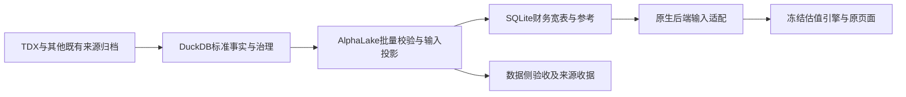

# SQLite估值输入快照调整 spec

日期：2026-10-11。用户批准后，v12代码、真实源链、5,227家全范围候选及网页协调发布已完成；收据见[项目状态](../implementation-status.md)。本spec是当前实施契约，不改变财务定义、估值方法或默认参数。

## 1. 目标与边界

DuckDB及其原始归档负责完整标准事实、来源解析、审核、冲突、期间转换和数据诊断；SQLite只交付valuation实际消费的财务宽表、参考与必要上下文。valuation从这些输入执行既有调整、WACC、FCFF、预测、终值及股权桥接。

本轮整理存储与取数，估值公式、默认假设、用户覆盖、研发寿命、资产代理和行业/货币选择保持现状；复用现行主库，不因撤表重新采集或重建标准事实。网页发布后的财务与已接入参考读取只依赖自足的SQLite，不启动Go、不打开DuckDB、不查PDF，也不依赖导出中间文件。研究和详细源审核显式查询数据侧，不借网页快照建立第二套标准事实库。

## 2. 表的处置

| 现有表 | 目标处置 | 职责去向 |
|---|---|---|
| `companies` | 保留上游宽表及列契约 | 公司输入、价格、市值、税率及日期锚点 |
| `financials_annual` | 保留上游宽表及列契约 | 年度经营、余额和研发历史 |
| `financials_quarterly` | 保留上游宽表及列契约 | 真实单季及原页面历史展示；不成为累计TTM额外门槛 |
| `ingest_log` | 保留原上游表 | 导入汇总，不写逐事实证据 |
| `financials_ttm` | 保留已有扩展 | 已校验的同窗TTM流量与最新余额，复用`PreparedTTM` |
| `metadata` | 保留、限定内容 | 发布版本、单位、规则版本及下节的紧凑输入上下文 |
| `reference_release`、`reference_value`、`reference_company`、`reference_issuer_association`、`reference_wacc` | 保留现有参考契约 | 已批准人民币及Damodaran参考、发行人关联和会话版本绑定 |
| `export_cells` | **撤销** | 确定性转换及详细诊断归数据侧；运行端只保留必要状态与来源引用 |
| `standard_facts` | **撤销** | 标准事实只由DuckDB标准查询提供 |
| `standard_records` | **撤销** | 源定位及完整来源记录由DuckDB/归档提供 |
| `reviewed_source_zeros` | 一并退出SQLite | 完整审核与撤销链留在主库，已审核输入带审核标识交付 |
| `export_universe` | 一并退出SQLite | 候选范围、身份拒绝及完整分母进入既有发布范围清单和收据 |

新快照使用`alphalake-sqlite-v12`。撤销是停止创建和读取上述表，不是改名、建视图兼容或把全量长表塞入JSON。完整源金额、源位、逐字段公告/哈希、PDF正文和审核包不得复制进消费库。参考表不因这次整理改地域、换来源或恢复上游未经审核的回退。

必要性结论：三张主要辅助表是本项目新增，[已核对的上游基线](../../valuation/UPSTREAM.md#准确上游比对2026-10-04)不要求；现行本地调用方利用它们重取事实、恢复证据和检查状态，这些职责须迁移而非删除。只读审计中三表合计约1,135.95MiB，占现行SQLite约98.25%；公司、年度、季度、TTM四张宽表合计12.73MiB。该数值用于解释改造原因，不是新库体积承诺。两张治理表随同整理，以免消费库继续承担审核与全范围候选管理。

## 3. 最小输入上下文

不增加替代事实表。复用`metadata`：全库键保存来源库哈希、财务内容签名、输入规则/程序版本、财报期、信息截止、单位、参考版本及发布范围签名；每个已导出证券最多一条`input_context:<ticker>`。

证券上下文仅允许：

- 证券身份ID；实际输入期间的源记录引用。源包哈希按版本在全库共享一次，不逐字段复制。
- 报价日、股本基期及必要取得/运行时点、来源标识；完整收盘及14日窗口验证在导出时完成。
- `PreparedTTM`当前已消费的上下文：真实起止、确定性公式标识、当前/上年累计收入和EBIT、季度数量，以及可得的上年同截止月TTM收入、币种、单位和来源引用。只有这些必要观察金额随输入交付，不存整套原始累计报表。
- 数据例外的稀疏记录：实际缺项或冲突原因、逐期间审核引用；获准资产代理范围按固定规则说明，市值代理由市场上下文说明。普通已供给单元格及固定代理状态由宽表和规则重建，不单独保存`available`行；固定范围说明复用规则标识，不重复长文。例外须标明目标列和真实期间，不把NULL或0当作原因。

上下文的键、类型和范围由代码白名单校验；不执行数据库表达式。输出可包含现有的事实/来源引用，但不要求业务用户理解源字段编号。完整标准金额及源精度核对留在主库/原始归档，SQLite宽表保持原百万元/百万股数值及精度，不恢复源编码已经丢失的小数。

发布收据保存范围、规则、来源引用、例外与验收汇总；既有不可变详细证据保留，按发布标识及来源内容签名定位。实际模型输入由宽表和上下文重建，完整标准金额/逐格组成通过主库与归档按需查询，不在每次导出后另存全量事实或逐格证据JSON。接口明确区分“输入来源引用”与“完整证据已展开”：没有完整源金额时不能伪装已展开，也不能因为没有内嵌原文而拒绝已校验的数值。

禁止将全部历史事实、325个目标单元格的证据数组或完整审核文档搬进每证券上下文。上下文规模应由实际输入期间及例外决定，实施时单独测量最大值、总量和重复内容；若超过宽表所需，应回到数据侧拆除重复，不能用压缩大JSON掩盖边界问题。

## 4. 数据投影和期间契约

复用`ExportFinancialSQLiteRows`及完整标准字段目录，单次只读事务冻结范围和来源，批量输出宽行。AlphaLake导出适配负责现有确定性转换；Python写入端批量写宽表和紧凑上下文，不再按每个标准事实/目标单元格执行INSERT，不导入估值引擎计算数据。

保持已公布年度和季度展示窗口，不以减少年份来宣称存储优化。取数使用实际期间集合：年度年末、展示季度、季度差分所需前期、当前TTM及上年同比的累计组成；各字段限定自己的期间。旧季度不因落入年度最早日期与当前期之间而全部导出。主库完整历史保留，默认不补采更早数据。

| 输入 | 交付规则 |
|---|---|
| 年度 | 原财年金额、偏移和NULL保留；收入/EBIT缺失不删除可用研发或其他列 |
| 单季 | 同年累计差分，Q1直接取累计；前期缺失则NULL，不制造季度 |
| 当前TTM | 全年＋本年累计−上年同月累计；年末走年度入口 |
| 同比TTM收入 | 上年同截止月对应的累计三项，缺项留空，不影响已完整的当前TTM |
| 余额、股本 | 最新报告期末，不累计、不差分、不借旧值补缺 |
| 税率、市值 | 既有年度会计税率和报价×报告期股本代理；非预测税率或真实多股类市值 |
| 债务、现金、投资 | 原组成、缺项及获准代理规则；不改变其估值范围或数值 |

身份、单位、范围、非有限值、源冲突和有效审核绑定仍在数据侧校验；不合格值不能借撤表变成可用。已批准的源零继续为0，NULL继续未知，研发队列按实际摊销政策检查。公告日期缺失不新增当前金额门槛。

## 5. 后端与工具调整

| 调用方 | 必须调整的内容 |
|---|---|
| `internal/store/duckdb/financial_sqlite_export.go`、`tools.export_alphalake_sqlite` | 明确期间投影和上下文，批量写宽表，删除辅助表DDL及逐格/逐事实写入 |
| `data_sources.us_cn_hk_db` | 只读宽表、参考和紧凑上下文；移除`load_standard_facts`与来源JSON JOIN，不恢复旧快照读取 |
| `api.database` | 从已交付上下文构造原`PreparedTTM`及同比诊断，不再从SQLite标准事实重算；保留同范围合并资本构造及现有可编辑来源初值 |
| `/api/database/company` | 原公司/年度/季度金额和现有TTM保留；删除完整`standard_financials`源长表输出，改为明确的输入来源上下文 |
| `/api/database/compatibility` | 继续按同一必需/条件/可选规则检查输入值、例外和选定方法；输出缺项、代理、来源引用，不遍历源事实库 |
| `check_native_sqlite`、`audit_native_coverage` | 市值状态与身份范围从输入上下文/冻结范围收据读取；拒绝、范围外和全部分母保留 |
| `publish_native_valuation`、`csi300_valuation` | 新鲜度、范围、内容签名改读新契约；发布仍须完整范围验收，网页运行不依赖验收目录 |
| `review_native_policy`、`evaluate_native_policy` | 年度值从宽表读取；须展开独立来源时显式调用数据侧标准查询，不能重建SQLite事实长表 |
| `cyclical_valuation`、`reported_native_credit` | 投资收益/公允价值、利息及租赁组成等额外源事实通过既有AlphaLake批量标准出口获取；限定字段与期间，不逐证券启动进程 |
| Skill、KB用法说明及测试 | 数据查询引向主库标准出口；原生估值仍使用同版SQLite/API，同步新来源/诊断形态和拒绝断言 |

详细源查询沿现有AlphaLake数据入口，第一期不新建HTTP数据服务、MCP或第二份数据库。数据研究可以在自己的冻结运行中取得事实，但与网页估值比较时须核对同范围财务/参考内容签名；文件哈希因无关预告更新而变化不等于财务值变化，未核对不能冒称同版输入。缺可追溯版本时明确无法复验，不从最新主库静默补旧报告。

HTTP估值请求、页面及用户编辑流程保持现状。后端来源/诊断响应形态随v12显式更新全部调用方，不保留`standard_financials`等旧别名。适配只装配现有typed输入，**不修改`valuation/backend/engine/`**；若现有类型确实无法表达，列出具体阻碍进入[TODO](../../valuation/TODO.md)，不能在本轮绕过冻结加算法。

## 6. 实施与切换

1. 冻结现行完整发布范围、财务/参考输入和默认估值基线；保存v11只读快照及完整审核/来源收据。以主库标准查询作为金额真值，不能把旧长表结构当新契约要求。
2. 修改数据投影、写入、读取和所有当前工具，先做小型样本及篡改拒绝；更新spec、操作指南、Skill和测试。新代码仅支持v12，旧证据按原提交复验。
3. 从主库可验证重建v12候选；旧快照中存在而主库未保存的不可重建证据须先核实并归档，不能直接DROP。保持同一证券/财务/参考/行情范围，不混入新同步或默认政策变化。
4. 完成下节全部验收，再按现有流程将运行代码与快照原子协调切换，重开数据库并用真实API核验。失败恢复对应版本的代码和旧快照，不在新代码中加入旧版回退。
5. 成功重开后清理可重建迁移副本，保留哈希、原因和验收收据。动态文件仍在workspace/derived，唯一网页快照仍为workspace/valuation.sqlite。

## 7. 验收与停止条件

**数值与范围：** 固定原完整发布分母；公司、年度、季度、TTM四张宽表每个值、NULL、0、偏移、税率、市值及日期锚点逐项一致，参考内容和选择不变。对必需/条件/可选准入、研发缺历史、源冲突、获准代理及金融范围外逐类回归。来源表示可以变化，缺项原因和警告含义不得丢失。

**估值等价：** 先用同一组已冻结完整模型输入检查引擎结果，再用新旧适配所得输入比较经济字段。协议版本、来源引用及运行ID单独比较；不能删除经济字段来取得哈希一致。全范围候选及真实网页API的输入、WACC、forecast、FCFF、终值、股权桥接和每股值保持一致；差异先定位数据/适配错误，本轮不批准借此改方法或默认。

**错误与独立运行：** 上下文/参考缺失、错误身份/单位/期间、内容篡改与审核撤销须有拒绝；未知日期不阻断金额。候选失败不得覆盖发布库。停止数据服务、移走导出临时目录后，已发布网页估值仍可读取自足快照；详细研究取证需要数据侧时应明确其独立依赖。

**结构与性能：** 新SQLite不存在五张撤销表及其替代长表/视图；不保留全量标准事实或逐格证据大JSON。完整同范围测量体积、导出/重放、原生API取数耗时及峰值内存，与`workspace/derived/sqlite-storage-audit/`基线及现行导出对照，注明冷暖缓存。体积须显著缩小，不能靠删历史、删拒绝公司、删证据或扩大内存取得结果；导出和取数不应出现未经解释的回退。小样本26.3%页布局收益不作为全库目标或完成证明。

大库和全局测试串行放在已核验1GiB硬限额的独立服务中，沿[测试约定](../guides/testing.md)执行默认及对应`full`真实链；迁移验收是显式全范围任务。主库不因网页瘦身删事实，发布材料仍计量，不能把占用搬到另一份运行时必需文件便宣称完成。

任一经济值/准入变化、证据不可恢复、网页依赖主库或辅助长表仍存在，都不算完成。无公式及默认变更时在[引擎台账](engine-change-ledger.md)记录数据契约调整和数值影响为零的实际验证，不虚构新增估值方法。

实施及真实验收记录见[2026-10-11迁移](../history/sqlite-input-snapshot-v12-20261011.md)。本页继续作为后续数据接入和快照变更的规范。
